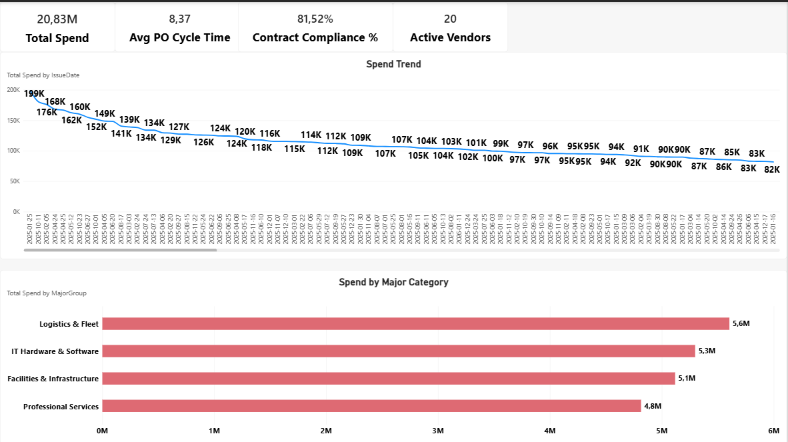
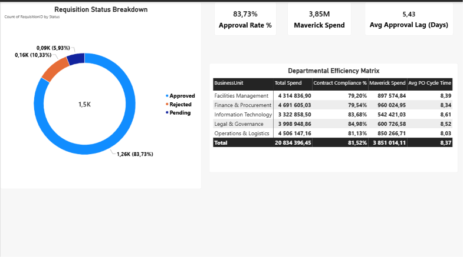
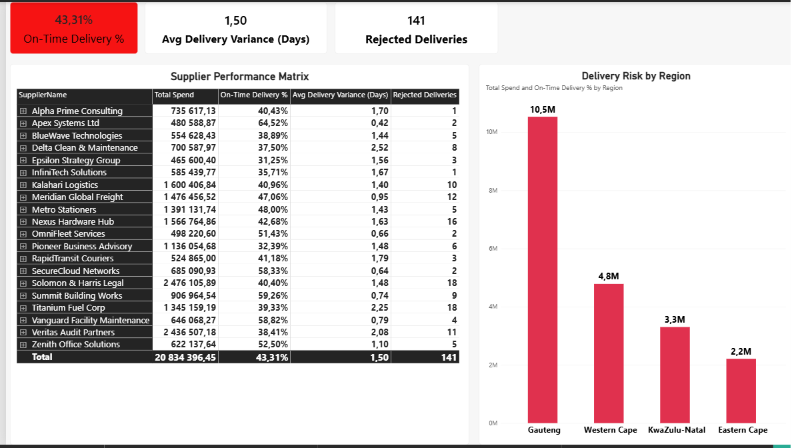

# Project 58: Procurement Performance & Compliance Analytics 📊

An end-to-end supply chain and financial expenditure analytics solution designed to track organizational spend efficiency, monitor purchase requisition-to-order velocity, evaluate supplier delivery risk, and identify contract leakage.

---

## 🚀 Project Overview
In enterprise and public-sector operations, visibility into procurement spend and supplier reliability is vital for financial control. **Project 58** simulates a full-cycle procurement ecosystem, spanning multi-departmental requisitions, purchase orders (POs), contract compliance tracking, and goods receipt verification. 

This project provides stakeholders with actionable insights into:
* **Spend Velocity & Category Concentration:** Where organizational capital is allocated.
* **Contract Compliance & Maverick Spend:** Financial leakage occurring outside pre-negotiated Master Service Agreements (MSAs).
* **Process Efficiency:** Bottlenecks in requisition approval and PO cycle times.
* **Supplier Performance & Risk:** Vendor delivery variances, on-time delivery (OTD) rates, and quality rejections.

---

## 🏗️ Architecture & Relational Data Model
The relational data schema was synthetically generated using a custom Python script (`pandas`/`numpy`) to replicate realistic enterprise procurement constraints. It consists of 6 interconnected tables:

1. **`Dim_Categories`**: Major spending groups and sub-categories (e.g., IT Hardware, Facilities, Professional Services).
2. **`Dim_Departments`**: Business units and cost centers tracking organizational demand.
3. **`Dim_Suppliers`**: Vendor directory containing regional distribution, risk ratings, and contract status.
4. **`Fact_Requisitions`**: Purchase request lifecycle data (creation date, approval status, estimated value).
5. **`Fact_Purchase_Orders`**: Issued purchase commitments linked to suppliers, contracts, and agreed lead times.
6. **`Fact_Receipts`**: Goods receipt logs capturing actual delivery dates, delivery variances, and quality inspection statuses.

---

## 🖼️ Dashboard Preview & Pages

### 1. Executive Procurement Overview (EPO)
Provides leadership with high-level financial exposure metrics, monthly spend trends, and category breakdowns.
* *Key Metrics:* Total Addressable Spend, Contract Compliance %, Average PO Cycle Time, Active Vendors.
* 

### 2. Process Efficiency & Compliance (PE&C)
Focuses on internal workflow velocities, approval lag times, and departmental compliance versus unmanaged spot buys.
* *Key Metrics:* Requisition Approval Rate %, Maverick Spend (Spot Buys), Approval Lag (Days).
* 

### 3. Supplier Performance & Delivery Risk (SP&DR)
Evaluates supply chain stability, highlighting high-risk vendors, delivery lead-time variances, and quality rejection rates.
* *Key Metrics:* On-Time Delivery (OTD) Rate %, Average Delivery Variance (Days), Rejected Deliveries Count.
* 

---

## 🧮 Core DAX Measures
Here are key analytical formulas implemented in the Power BI data model:

* **Contract Compliance %:**
  ```dax
  Contract Compliance % = 
  VAR TotalPOValue = SUM('Fact_Purchase_Orders'[POValue])
  VAR ContractedValue = CALCULATE(
      SUM('Fact_Purchase_Orders'[POValue]), 
      'Fact_Purchase_Orders'[ContractID] <> "SPOT-BUY"
  )
  RETURN DIVIDE(ContractedValue, TotalPOValue, 0)

  Avg PO Cycle Time = AVERAGEX(
    'Fact_Purchase_Orders',
    DATEDIFF(
        RELATED('Fact_Requisitions'[RequisitionDate]), 
        'Fact_Purchase_Orders'[IssueDate], 
        DAY
    ))
    On-Time Delivery % = DIVIDE(
    CALCULATE(
        COUNTROWS('Fact_Receipts'),
        'Fact_Receipts'[DaysVariance] <= 0
    ),
    COUNTROWS('Fact_Receipts'),
    0)


📈 Analytical Conclusion & Business Value
Through this analytics suite, organizations can achieve immediate operational efficiencies:

* **Mitigating Maverick Spend:** Quantifying unmanaged spot purchases highlights departments requiring stricter adherence to Master Service Agreements, directly preserving capital.
* **Streamlining Workflows:** Pinpointing approval bottlenecks across business units accelerates requisition-to-order velocity, minimizing operational downtime.
* **Data-Driven Vendor Management:** The supplier scorecard framework equips procurement teams with empirical evidence to renegotiate terms with high-variance or high-risk vendors.


